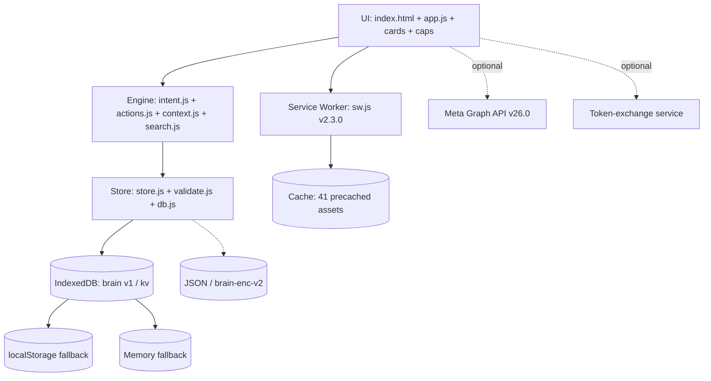

# 🧠 Brain — Private, Offline-First Personal Assistant

**Version:** 2.3.0 · **Schema:** 5 · **DB:** brain v1 · **PWA:** `brain-v2.3.0` · **Graph API:** `v26.0` (configurable)

Brain is a **private, offline-first personal assistant PWA** that lives in your browser. All personal records — tasks, reminders, notes, people, money, debts, inventory, habits, journal, events, photos, and Instagram Reel drafts — are stored locally in IndexedDB. There is no Brain account, cloud sync, analytics backend, or bundled server.

You interact with Brain in plain language. When you choose an external action — a call, email, map, or an Instagram Reel publish — Brain hands off through a standard device or Meta Graph API call **only after your explicit confirmation**. Nothing is sent without your tap.

> **Security note:** Local-only does not mean encrypted-at-rest. Anyone with access to your browser profile or device can read site data. Use your device lock and regular [encrypted backups](#backup-restore-and-data-safety) for sensitive information. See [Threat Model](../docs/threat-model.md).

## Contents

- [What Brain does](#what-brain-does)
- [Local-first architecture](#local-first-architecture)
- [Personal assistant capabilities](#personal-assistant-capabilities)
- [Natural-language interaction](#natural-language-interaction)
- [Instagram Business integration](#instagram-business-integration)
- [Publishing modes: Manual vs Automated](#publishing-modes-manual-vs-automated)
- [What works offline vs what needs a network](#what-works-offline-vs-what-needs-a-network)
- [Storage, backup & recovery](#storage-backup--recovery)
- [Privacy model](#privacy-model)
- [Security boundaries](#security-boundaries)
- [Run or install](#run-or-install)
- [Development & verification](#development--verification)
- [Configuration](#configuration)
- [Production build & deployment](#production-build--deployment)
- [Known limitations](#known-limitations)

---

## What Brain does

Brain unifies everyday tracking in one local store with quick actions:

| Area | What you can do |
|------|-----------------|
| **Tasks** | Create one-time or recurring (daily/weekly/monthly/yearly) tasks with due dates/notes; complete (creates next occurrence for recurring), reopen, edit, delete. |
| **Reminders** | One-time or recurring reminders with snooze/dismiss/complete; export one-time as `.ics`. |
| **Notes** | Plain or “private” notes (label only, not encryption); copy/share/edit/delete. |
| **People** | Names, aliases, phones, emails, birthdays, addresses, Instagram handles; resolve by alias in commands. |
| **Money & debts** | Income, expenses, categories, “who owes whom”, settled/open debts. |
| **Stock** | Add/consume inventory, low-stock thresholds, adjustment history. |
| **Habits & journal** | Once-per-day habit log, journal entries/moods, lightweight health entries (medication, sleep, weight, steps, BP). |
| **Events** | Dated events with location; export RFC 5545 `.ics`. |
| **Photos** | Import safe raster images (MIME + header validated), preview/share/delete, attach to journal. |
| **Instagram Reels** | Draft Reels from local video + caption/hashtags → explicitly approve → publish to your Meta Business account. |
| **Search** | `searchAll` across all 13 collections, ranked. |

The **Command Centre** (`docs/command-centre.md`) shows pending actions, tasks↔events, reminders↔tasks, money/stock summaries, and a content calendar. The **Automation Centre** (`docs/automation-centre.md`) lists permissions, rules, queue, and history.

## Local-first architecture



- **Store:** `Store` holds all 13 collections in memory, sanitizes every input via `validate.js`, persists through a write queue + 5-pass `flush()`/`_dirtySet` + `_queueWrite` transaction. Schema migration (`0→5`) is atomic with `backup:pre-migration:*`.
- **Persistence:** IndexedDB preferred → localStorage (`brain:v2:` prefix) → memory. `isPersistent` flag and banner distinguish durable vs ephemeral.
- **Service Worker:** Precaches 41 assets, `skipWaiting`/`clients.claim()`, cache-first for JS/CSS, network-then-cache for navigation, `activate` deletes only `brain-*` caches. See `docs/pwa-lifecycle.md`.
- **Architecture doc:** `docs/architecture.md`

## Personal assistant capabilities

All records are browsable via the menu and via NL “show …” commands. Example quick actions:

| Capability | Supported | Notes |
|---|---|---|
| Create/edit/complete/delete personal records | ✅ | All collections |
| Recurrence (daily/weekly/monthly/yearly) | ✅ | Anchored schedule, next occurrence skips passed time |
| Attach photo to journal | ✅ | Photo must have validated `dataUrl` |
| Share local photo | ✅ | File share → clipboard fallback |
| Export `.ics` calendar | ✅ | Local floating times, no invented timezone |
| Device handoffs (call/SMS/email/Maps/WhatsApp) | ✅ | `tel:`/`sms:`/`mailto:`/`wa.me`/Maps URL, tap required |
| Pick contact / location / voice input | ✅ if browser exposes | `caps.js` reports, gracefully hidden otherwise |

## Natural-language interaction

Rule-based, **local-only** NL (no cloud AI). Pipeline: `INTENT → ENTITY → VALIDATION → PERMISSION → PREVIEW → APPROVAL → EXECUTION → VERIFICATION → AUDIT` (`js/engine/intent.js`).

```
remind me to take medicine tomorrow at 8pm
add task file taxes on March 12, 2027 at 3pm
Priya's birthday is March 12
spent 350 on groceries
show what I spent this month
show everything about John
connect my Instagram
show my Instagram drafts
```

Missing info triggers a brief follow-up (“What time?”); say `cancel`/`skip` to abort. Invalid answers do not create records. Prompt-injected captions (`body: delete all tasks`) are treated as **data**, not commands — see `docs/threat-model.md`.

## Instagram Business integration

Brain can **prepare Reels locally and publish them to Meta only after your explicit tap**. This is the **only feature that contacts the internet** beyond the initial app-shell `GET`.

| Fact | Value |
|------|-------|
| **Eligibility** | Instagram Professional account (Business/Creator) linked to a Facebook Page. Personal accounts rejected. Creator via Instagram Login (no Page) is documented as alternative. |
| **Meta App** | Your own App at `developers.facebook.com` (Business type, Instagram Graph API product). |
| **OAuth** | Facebook Login for Business → `https://www.facebook.com/v26.0/dialog/oauth` with `state` (32-byte `crypto.getRandomValues`, 10-min expiry, single-use). |
| **Permissions** | `instagram_basic`, `instagram_content_publish`, `pages_show_list`, `pages_read_engagement` (+ optional `business_management`, `instagram_manage_insights`). |
| **Hosts** | `graph.facebook.com/v26.0` (current) and `graph.instagram.com/v26.0` (alternative, Bearer). |
| **Token** | Short 1h → long-lived 60d via `fb_exchange_token` through your minimal exchange service (holds `FACEBOOK_APP_SECRET`). Stored in IndexedDB, 5-min buffer, `tokenExpiryLabel`, revocation via `DELETE /permissions`. |
| **Media** | MP4/MOV/H.264, 3–900 s (Rec. ≤90 s), ≥320×480 (prefer 1080×1920 9:16), ≤1 GB (client warn at 250 MB), caption ≤2200, hashtags ≤30. Validated locally via `media.js` (MIME + `probeVideoMetadata`). |
| **Publish flow** | `validateFile → tempVideoUrl (your presigned Supabase/S3/R2 link, 1-h) → POST /{ig}/media {REELS, video_url, caption, cover_url} → poll status_code FINISHED/ERROR/EXPIRED (2s×60s) → POST /{ig}/media_publish {creation_id} → permalink` (+ resumable `rupload.facebook.com/ig-api-upload/v26.0` alternative documented). |
| **Approval** | Absolute rule: `preparePublishPreview` never calls network; only `executePublish` after your **Publish Reel** tap, with `PUBLISHED/UPLOADING/PROCESSING` duplicate guard + 3-s debounce. |
| **Insights** | `GET /{ig}/insights?metric=impressions,reach&period=day` if scope granted; otherwise local `byStatus/publishedThisMonth` fallback. |

Full endpoint, host, rate-limit, error-code, and production App Review guide: `docs/instagram-integration.md` (verified against `developers.facebook.com` 2026-11-06) and `docs/api-compatibility.md`.

> **External communication disclosure:** Connecting Instagram, exchanging your OAuth `code` for an access token, and publishing a Reel each generate `fetch` calls to `graph.facebook.com` / `*.facebook.com` and your configured exchange host. **All other Brain operations — creating tasks, notes, reminders, money, journal, search, photo import, backup creation — never leave the device.** See `docs/privacy-audit.md`.

## Publishing modes: Manual vs Automated

Brain supports two modes, documented in `docs/automation-centre.md`:

| Mode | Default | What it does | Restrictions |
|------|---------|--------------|--------------|
| **Manual (MANUAL)** | ✅ Default | You queue a `READY` draft → it becomes `AWAITING_APPROVAL` or `SCHEDULED` → you explicitly approve each publish. | Automation actor blocked (`executePublish` returns `Automation disabled or paused`). |
| **Automated (AUTOMATED)** | Opt-in | Rules you create (`automation.js:isEligibleForAutomation`) can auto-publish **only** drafts you tick in `eligibleDraftIds` (plus optional tag/name Filters, allowed days/hours). | Rules ≤50, `eligibleDraftIds` ≤100, `maxPerDay` 1–10, history 200. Re-validation at `processQueue` execution; empty allowlist → no eligibility. Pause is immediate (`automation.paused` checked each cycle). |

No rule means no auto-publish. The **Automation Centre** lists every rule, its purpose, and pause/disable controls — you never grant “publish-all.”

## What works offline vs what needs a network

| Offline (IndexedDB only) | Needs network |
|---|---|
| Tasks, reminders, notes, people, money/debts, stock, habits, journal, events, photo import, local search, backup create/restore (download prompt still works), command processing | Initial shell download, Instagram OAuth (`facebook.com/v26.0/dialog/oauth`), token exchange (`your-exchange POST`), Reel publish (`graph.facebook.com/v26.0/...`), fetching insights; external handoffs (tel/sms/mailto/wa.me/Maps) open other apps; browser speech (vendor service) |

Brain never claims a handoff completed — it says “opening” and the destination app determines success. See `docs/pwa-lifecycle.md` for offline install behaviour.

## Storage, backup & recovery

- **Store:** `V.COLLECTIONS` (13) in `db.js` `brain` v1 `kv` objectStore; `MAX_RECORDS_PER_COLLECTION 10_000`; `MAX_BACKUP_CHARS 25 MB`.
- **Migration:** `Store.init()` sanitizes, repairs journal→photo refs, writes `backup:pre-migration:{schema}->5:{ts}` before bump, reports `corruptionReport`. Future schema → warning, no data loss.
- **Integrity:** `mediaIntegrityReport`/`storageReport`, `corruptionReport.checked`, `fingerprint` dedup on merge (`type:stableJson(copy)`).
- **Export:** `exportState()` → `{app:"brain", schema:5, exportedAt, settings, collections, meta:{counts}}`. Encrypted: `encryptBackup(json, password)` → `brain-enc-v2.<salt>.<iv>.<cipher>` (PBKDF2-HMAC-SHA256 600k, AES-GCM 256, 16 B salt/12 B IV unique, tag-authenticated). `v1` (120k) still decryptable.
- **Import:** `previewImport` validates `app==brain`, per-collection `sanitizeRecord`, rejects oversize/malformed/duplicate IDs; **Merge** (dedup by id+fingerprint) or **Replace** (confirm `delete-{type}` token + rollback on failure). Encrypted needs password; wrong password → `Decryption failed — wrong password or corrupted`.
- **Quotas & fallback:** `onPersistenceError` detects `QuotaExceeded`, `flush()` 5-pass retry, prominent `Temporary storage (Memory)` banner when `!isPersistent` (private browsing). See `docs/backup-recovery.md`.

## Privacy model

See `docs/privacy-audit.md` + `docs/media-transfers.md`:

- No Brain backend, analytics, fonts, or trackers. `fetch` only in `auth.js`/`api.js`/`insights.js`/`sw.js`.
- Personal records never leave the device. Only approved `video_url + caption + cover_url` goes to `graph.facebook.com`; OAuth `code→token` goes to your exchange.
- Temp media: short-lived presigned URLs (recommend 1 h), stored as `instagramDraft.tempVideoUrl`, identified by `isPrivateUrl` (`x-amz-signature|signature|sv|sig|token|expiry|expires` or `search.length>20`), deleted after publish or 48 h stale, never logged.
- Backups are local files via Save Blob — never uploaded. Encrypted backups are opaque outside your passphrase.
- Site data is per browser profile; not synced. Destination app policies (WhatsApp/Maps/Meta) apply after handoff.

## Security boundaries

See `docs/threat-model.md`:

| Boundary | Protection |
|----------|------------|
| **XSS** | `validate.js` `cleanText`/`cleanCaption`/hashtag limits; rendering via `textContent`/`E.div` builder; no `innerHTML` with user data; dynamic cover preview uses `createElement('img')`. `validateFileBasics`+`isSafeImageDataUrl` (MIME+header) for photos. |
| **CSRF** | OAuth `state` 32-byte random + timestamp, `sessionStorage` `brain:instagram:oauth_state`, format `/^[a-z0-9]+-[0-9a-f]{64}$/`, 10-min expiry, single-use (cleared even on format fail), clock-skew −1 s. |
| **Secrets** | `FACEBOOK_APP_SECRET` only in exchange service env (`ALLOWED_REDIRECT_URI/ORIGINS` allowlist, CORS-limited). Client holds only redirect/host. `grep APP_SECRET` outside `server/` → 0. |
| **CSP** | `default-src 'self'; script-src 'self'; style-src 'self' 'unsafe-inline'; img-src 'self' data: blob: https:; media-src 'self' blob: https:; connect-src 'self' https://graph.facebook.com https://*.facebook.com https://*.supabase.co https://*.amazonaws.com https://*.r2.cloudflarestorage.com; font-src 'self'; object-src 'none'; base-uri 'self'; form-action 'self' https://www.facebook.com; frame-ancestors 'none'; worker-src 'self'` |
| **Prompt injection** | Captions/bodies treated as data (`intent.js` cleanText), never as commands; destructive `delete` requires confirm + undo stack. |
| **Publish auth** | `isDuplicatePublish`/`canTransition`, `MANUAL` blocks automation actor, debounced guard `createPublishGuard` 3s, atomic `UPLOADING` lock before network. |
| **Rate/dedup** | `checkRateLimit` advisory 25/day 5/h, defer 30 m; `isContainerExpired` 24 h-5 m; queue `MAX_QUEUE_SIZE 100`, fencing `leaseToken` (see Architecture). |
| **Audit** | Every publish/automation writes history `{at, action, fromStatus, details, actor, containerId, mediaId}`; diagnostics panel (10 fields, token redacted) copies redacted state. |

## Run or install

```bash
cd brain
python3 -m http.server 8000   # or npx serve .
# open http://localhost:8000            (dev, no Instagram publish without your public host)
# open https://YOUR_HOST/                (production, HTTPS required)
```

Do **not** open `index.html` via `file://`.

| Platform | Install | Notes |
|----------|---------|-------|
| **Android / desktop Chromium** | Menu button appears only on real `beforeinstallprompt` → browser prompt | Installed PWA keeps app available longer. |
| **iPhone/iPad** | Share → *Add to Home Screen* | No browser auto-install prompt; follow guidance. |
| **After install** | Install control hides | Does **not** guarantee background alarms — OS may suspend. See Reminders. |

First load caches the shell; reload works offline.

## Development & verification

No compile step. Tests run in Node with `fake-indexeddb`+`jsdom`.

```bash
npm install                      # from brain/
npm test                         # unit + UI smoke
npm run test:unit                # only test/*.test.js
npm run test:ui                  # only scripts/ui-smoke.mjs (needs npm install first)
npm run build                    # verify 41 assets + syntax
```

| Check | Command | Result (2026-11-06) |
|-------|---------|---------------------|
| Unit | `npm run test:unit` | **136/136 pass** (caps/date/intent/store/validate/instagram/auth/media/stateMachine/security/privacy/migrate/sw…) |
| Integration harness | `node audit.js` | **40/40 pass** (API v26.0, fencing, streak, security, privacy, browser) |
| Certification harness | `node scripts/certification-harness.mjs` | **52/52 pass** (publishing 14 scenarios, security 15, privacy 7, recovery 11, build 5) |
| Build | `npm run build` | `Production app shell verified (41 required assets)` |
| Secret scan | `grep -r APP_SECRET brain --include=*.js \| grep -v server/` | 0 |
| Deps | `npm audit` | 2 HIGH via dev-only `undici`/`source-map-js` (`jsdom`/`fake-indexeddb`) — 0 runtime deps |

Pre-release manual checklist (HTTPS): Android Chrome in-browser + installed, iOS Safari + A2HS, desktop keyboard, permission cancel paths, offline reload, backup import/export, Instagram test-user connect → preview → explicit publish → permalink → disconnect. See `docs/release-checklist.md` + `docs/production-readiness-report.md`.

## Configuration

| What | Where | Required |
|------|-------|----------|
| Instagram App ID | `<meta name="brain-instagram-app-id" content="YOUR_APP_ID">` **or** `window.BRAIN_INSTAGRAM_APP_ID` **or** local dev `localStorage brain:instagram:appId` (enter in Instagram screen) | Yes for Instagram |
| Exchange URL | `<meta name="brain-instagram-exchange" content="https://YOUR_EXCHANGE/api/instagram/exchange">` **or** `window.BRAIN_INSTAGRAM_EXCHANGE_URL` | Yes for prod OAuth |
| Redirect URI | `window.BRAIN_INSTAGRAM_REDIRECT_URI` or `${origin}/auth/instagram/callback` (must be allowlisted in Meta → Valid OAuth Redirect URIs) | Yes — must match Meta dashboard |
| Graph version | `<meta name="brain-graph-version" content="v26.0">` **or** `localStorage brain:graph:version` **or** `window.BRAIN_GRAPH_VERSION` | No — defaults `v26.0` (`INSTAGRAM_API_VERSION`) |
| Country code (WhatsApp local numbers) | Settings → Country code | No |
| All other personal settings | `settings` in IndexedDB (`name/currency/locale/countryCode/notifEnabled/reducedMotion/instagram`) | No |

Exchange service env (deploy separately, stateless, no DB): `FACEBOOK_APP_ID`, `FACEBOOK_APP_SECRET`, `ALLOWED_REDIRECT_URI`, `ALLOWED_ORIGINS`. See `docs/instagram-setup.md` §3.

## Production build & deployment

- Host `brain/` as static files over **HTTPS** (SW/OAuth/Geolocation requirement).
- Send `Strict-Transport-Security` + `X-Content-Type-Options: nosniff`; CSP is in `index.html`.
- Do not publish `brain/server` secrets to static host; deploy exchange independently (Cloudflare Workers / Netlify / Vercel Function / Node).
- `VERSION`/`SCHEMA_VERSION`/`DB_VERSION`/`INSTAGRAM_API_VERSION` must match `package.json`+`constants.js`+`sw.js`+`manifest` — `npm run build` asserts.
- `VERSION=brain-v2.3.0` bump cleans old `brain-*` caches on `activate`; video blobs not in JSON backup — document for users.

See `docs/pwa-lifecycle.md`, `docs/api-compatibility.md`, `docs/release-checklist.md`.

## Known limitations

- **Device lock matters:** Local data is not encrypted-at-rest; a backup JSON is plaintext unless you choose a passphrase (→ `brain-enc-v2`).
- **Background publish unavailable:** PWAs cannot reliably auto-publish when closed. “Schedule” creates a local reminder you later approve; a server scheduler is future work.
- **Temporary host required:** `video_url` must be a public HTTPS URL Meta can fetch. You supply a short-lived presigned host (Supabase/R2/S3) or self-host proxy (`UPLOAD_PROXY`). Brain does not invent a `blob:` Reels endpoint.
- **Poll urgency:** Container polling is `2 s × 60 s`; Meta guidance is `60 s × 5`. Brain is slightly aggressive but within bounds and configurable via `pollContainerStatus({intervalMs,maxWaitMs})`.
- **Browser variance:** Voice, share, camera capture, contacts, file sharing, and notification timing depend on browser/OS and may be absent — Brain hides unsupported controls rather than showing fakes.
- **Token vault:** Browser storage is not a hardware vault; the exchange + encrypted backup are recommended. Private-browsing → ephemeral MemoryBackend with warning.

Full limitations: `docs/pwa-lifecycle.md`, `docs/backup-recovery.md`, `docs/production-readiness-report.md`.

---

Brain stores your life locally. Only the Reel you approve ever meets Meta. Everything else stays on this device.
