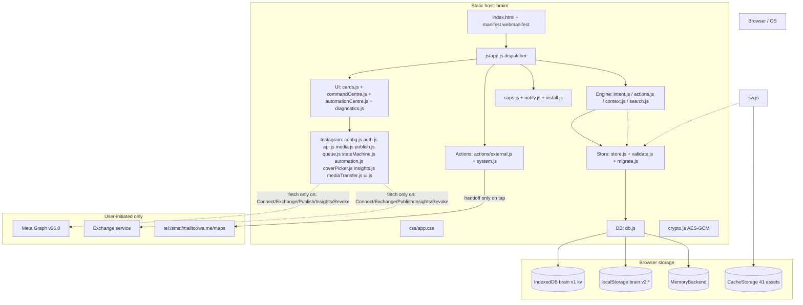
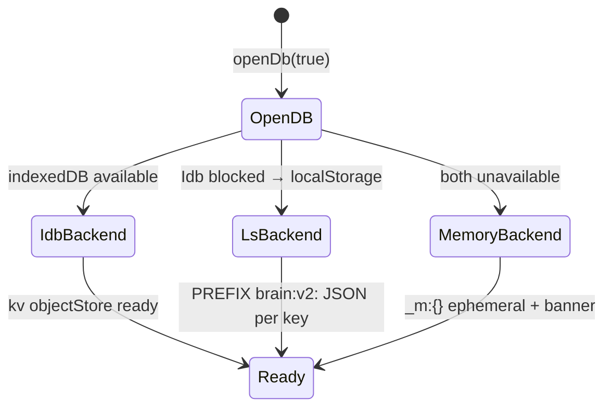
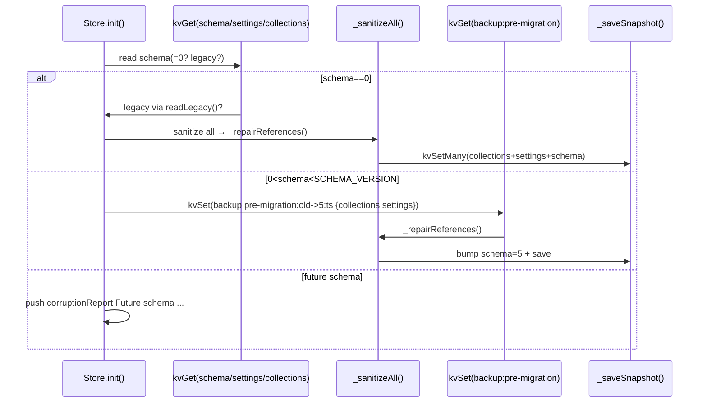
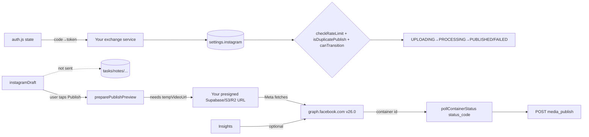

# Architecture — Brain v2.3.0

**Source authority:** `brain/js/**` (read 2026-11-06). This document reflects implementation, not plan.

**Stack:** Static ES-module PWA · No build/bundler · `VERSION 2.3.0`, `SCHEMA_VERSION 5`, `DB_VERSION 1`, `SERVICE WORKER brain-v2.3.0`, `INSTAGRAM_API_VERSION v26.0` · Zero runtime npm dependencies.

## 1. High-level



**Invariant:** Personal records (`task, reminder, note, person, money, debt, stockItem, habit, journal, event, photo`) never leave `Store` → `IDB`. Only an **explicitly approved** `video_url+caption` traverses `Instagram`.

## 2. Frontend modules

| Layer | Files | Role |
|-------|-------|------|
| **Shell** | `index.html`, `css/app.css`, `manifest.webmanifest`, `sw.js` | PWA shell, CSP, theme, offline cache. |
| **Dispatcher** | `js/app.js` | Single `runAction` + `Brain(handle)` router, undo stack, quota/toast, focus trap, sheet lifecycle, `Storage & media health`. |
| **Engine** | `js/engine/intent.js` (NL), `context.js` (pronoun/pending), `actions.js` (mutations), `search.js` (searchAll 13 collections) | `INTENT→ENTITY→VALIDATION→PERMISSION→PREVIEW→APPROVAL→EXECUTION→VERIFICATION→AUDIT`. |
| **Actions** | `js/actions/system.js` (ACTION constants + `canOffer/availableActions`), `js/actions/external.js` (tel/sms/mailto/wa.me/maps/calendar .ics) | Capability-gated handoffs. |
| **UI** | `js/ui/cards.js`, `commandCentre.js`, `automationCentre.js`, `diagnostics.js` | Render cards, command-centre search, automation rules, redacted diagnostics (10 fields). |
| **Caps** | `js/caps.js`, `js/notify.js`, `js/install.js` | Feature detection, notification routing, `beforeinstallprompt` + `controllerchange` update banner. |
| **Store** | `js/store/store.js`, `validate.js`, `migrate.js`, `db.js` | Persistence, validation, migration, recovery. |
| **Instagram** | See §6 | Isolated publishing boundary. |
| **Util** | `js/util/constants.js`, `date.js`, `util.js`, `crypto.js` | Central constants, date math, DSL `E.div`, AES-GCM. |

## 3. Persistence — IndexedDB with fallbacks



- **DB:** `brain` v1, single `kv` objectStore. Keys: per-collection array (`task`, `reminder`, … `instagramDraft`, `instagramPublication`), `settings`, `schema`, `instagram:queue`, `backup:pre-migration:*`, `instagramVideoBlob:{id}` (transient).
- **Limits:** `MAX_RECORDS_PER_COLLECTION 10_000`, `MAX_BACKUP_CHARS 25 MB`.
- **Write path:** `add/update/remove` → `_newRecord/_updatedRecord` via `sanitizeRecord` → optimistic memory mirror → `_queueWrite(() => db.kvSet[Many])` single queue; `addSync/updateSync/removeSync` → `_dirtySet` + `flush()` 120 ms debounced 5-pass drain (new mutations while flushing start next pass, bounded 5). Failure restores prior array and fires `_reportPersistenceError`.
- **Quota:** `isQuotaError(/quota|QuotaExceeded|storage full/)` → `onPersistenceError` → toast `QuotaExceeded` + `Temporary storage (Memory)` banner when `!isPersistent`.
- **Detection:** `store.corruptionReport {checked, issues[]}` (non-array, invalid records, future schema, read fail, removed count, migration backup fail) + `storageReport()/mediaIntegrityReport()` → Diagnostics panel.

## 4. Schema migration



- `V emptyCollections()` enumerates 13 collections; `sanitizeRecord(type)` coerces types, strips control chars, clamps lengths, validates MIME+header for `photo.dataUrl`, normalizes `INSTAGRAM_PUBLISH_STATES` legacy→uppercase.
- Referential repair: `photo` → `journal.photoId null` if dangling.
- `schema` key is the authority; a downgrade is detected as “future schema” warning, never auto-downgrade-delete.
- Migration backup `backup:pre-migration:{old}->{new}:{Date.now()}` retains exact pre-state for recovery.

## 5. Service worker

`VERSION=brain-v2.3.0`, `CACHE=VERSION`, `ASSETS` 41 entries (all `js/` modules + icons + `index.html`/`manifest.webmanifest`/`css/app.css`).

| Event | Behaviour |
|-------|-----------|
| `install` | `cache.open(CACHE).addAll(ASSETS)` → `skipWaiting()` |
| `activate` | Delete `brain-* ≠ CACHE` only (never IDB, never other app caches) → `clients.claim()` |
| `fetch` (GET + same-origin) | **Navigate** (`request.mode==='navigate'`): network→put-then-return, else cache→`index.html`→503 fallback. **Assets**: cache-first, then network→cache if `basic`. |
| `notificationclick` | `clients.matchAll` prefers focused/visible, `postMessage brain:reminder-*`, else `clients.openWindow(?brainReminderId)` |
| Update | `registration.onupdatefound` + `controllerchange` in `install.js` → `Update available — new Brain version ready` banner, explicit Reload required. |

No push subscription, no fake background scheduler — by design.

## 6. Natural-language action pipeline

`Brain.handle(text)` in `intent.js` → `context.js` remembers last person/task/reminder for pronoun resolution.

```
text → _instagramExtendedIntent → _instagramIntent → _query/_externalAction → _create (tasks/reminders/notes/people/money/stock/habit/journal/event) → fallback clarify
```

- **Enforcement:** Each handler returns `{action, params}` or `{clarify:true, question}`. Ambiguous or destructive without confirmation returns a clarification card, never a side-effect.
- **Prompt injection:** `caption/body` flows through `cleanText`/`cleanCaption` and is never fed back into `intent.js` parser — data stays data.
- **Undo:** `app.js` keeps last delete snapshot + `Undo` button → `restore`.

## 7. Command Centre

`commandCentre.js` + `engine/search.js` `searchAll(query, store)` tokenizes query, scores 13 collections, returns ranked hits (id + snippet). Features:

- Universal search across all 13 collections.
- Tasks-with-due-dates alongside Events (timeline).
- Reminders-with-active alongside open Tasks.
- Money totals / open debts / low stock.
- Notes + journal + content calendar grouped by `scheduledAt`.
- Pending actions (open tasks, active reminders, `READY/AWAITING_APPROVAL/SCHEDULED/FAILED` Reel drafts).

All local; never a server query.

## 8. Automation Centre

`automation.js` defines two modes (`MANUAL` default, `AUTOMATED` opt-in), ≤50 rules, each `{filters:{tags,namePattern,allowedDays,allowedHours,eligibleDraftIds≤100}, schedule:{freq,time,days}, limits:{maxPerDay 1..10}}`.

```
eligible = rule.enabled
        && status∈{READY,AWAITING_APPROVAL,SCHEDULED}
        && draft.id∈eligibleDraftIds (if list non-empty else tag/pattern requires at least one)
        && day∈allowedDays && hour∈[start,end)
```

`isEligibleForAutomation` runs at rule enqueue **and** at `processQueue` execution — no background bypass. `paused` checked each cycle; per-rule disable and global `Pause automation` are immediate. `history` last 200 `{at,draftId,ruleId,action,result,error,actor}`.

See `docs/automation-centre.md`.

## 9. Instagram integration boundary

**Goal:** Preserve local-first; Meta is reached only via the narrow `Instagram` boundary.



| Component | File | Responsibility |
|-----------|------|----------------|
| Config | `config.js` | `CONFIG` frozen getters (App ID via meta/global/localStorage, version via meta/localStorage/window → `v26.0`), `graphBase`, `oauthDialog`, `scopes`, `MEDIA_REQUIREMENTS`. |
| Auth | `auth.js` | `generateState/validateState(32B random, 10m, single-use, format+skew)`, `parseCallbackParams`, `exchangeCodeForToken/refreshLongLivedToken/revokePermissions`, `buildConnected/DisconnectedConnection`, `cleanCallbackUrl`, expiry helpers `isTokenExpired/tokenExpiryLabel/needsRefresh/getConnectionStatus`. |
| API | `api.js` | `graphFetch` (POST form-urlencoded + error code 190/4/10/200), `fetchUserPages/fetchInstagramBusinessAccount/fetchInstagramProfile/discoverInstagramAccount`, `createReelContainer/pollContainerStatus/publishContainer/publishReel/fetchPermalink/validateToken`. |
| Queue | `queue.js` | Durable `instagram:queue` with atomic append+duplicateCount rollback, `generateFencingToken`, `claimJob(→{entry,leaseToken})`, `renewLease`, `classifyRetry`, `recoverStaleJobs(5m)`, `processQueue`(rate defer 30m, per-rule `maxPerDay`, backoff `30s*2^(n-1)` cap1h + jitter, `EMERGENCY_STOP`). See `docs/api-compatibility.md`. |
| State | `stateMachine.js` | `STATES` 9 values, `LEGACY_MAP`, `ALLOWED_TRANSITIONS`, `normalizeStatus/canTransition/nextStates`, `isContainerExpired 24h-5m`, `isDuplicatePublish`, `checkRateLimit 25/5`, `buildHistoryEntry`. |
| Media | `media.js` | `validateFileBasics/validateFileBasics`, `probeVideoMetadata(videoElement,15s)`, `validateCaption/hashtags`, `buildCaptionWithHashtags`, `createVideoObjectUrl`. |
| Automation | `automation.js` | Rules as above, `makeRule/isEligibleForAutomation/recordAutomationExecution/canAutomationPublish/pause/resume`. |
| Publish | `publish.js` | `preparePublishPreview` (no network), `executePublish` (MANUAL guard, UPLOADING lock, debounce 3s, lock before net, stage FAILED with history, mediaId→publication record, temp URL cleanup), `recoverInterruptedPublishes`, `suggestHashtags/generateCaptionTemplate`. |
| Upload | `coverPicker.js`, `mediaTransfer.js`, `insights.js`, `ui.js` | Canvas frame extract, transfer-privacy doc (`isPrivateUrl/shouldCleanupVideoUrl`), insights fetch+local fallback, hub UI. |

No personal collection crosses this boundary. The exchange service holds `FACEBOOK_APP_SECRET` — never in `brain/`.

## 10. Media-transfer lifecycle

```
Select file → validateFileBasics + probeVideoMetadata → warnings → objectURL preview
          → user supplies tempVideoUrl (presigned Supabase/S3/R2, 1h)
          → draft saved (tempVideoUrl stored only in this draft)
          → previewPublishPreview (shows URL that will be sent)
          → Publish tap → createReelContainer(video_url) → Meta fetches URL → poll → publish
          → permalink + cleanup tempVideoUrl:null (+ 48h stale cleanup)
```

`TRANSFER_DOC` in `mediaTransfer.js` documents preferred vs current, isolation, lifetime, resumable alternative (`rupload.facebook.com/ig-api-upload/v26.0`), proxy option.

## 11. Backup & recovery

- `exportState()` flushes `_dirtySet` → `{app:"brain", schema:5, exportedAt, settings, collections, meta:{counts}}`.
- Encrypted: `exportStateEncrypted(password)` → `encryptBackup` PBKDF2 120k (`v1`) / 600k (`v2` OWASP) + AES-GCM 256, 16 B salt + 12 B IV unique, `brain-enc-v1/v2.<salt>.<iv>.<cipher>` base64.
- `previewImport` validates `app==brain`, sanitizes each record, rejects non-brain/oversize/malformed/empty-id/dup, counts valid per collection, reports errors.
- `mergeBackup`/`replaceAll` + `_repairReferences`, fingerprint dedup `stableJson`, `safeDeleteCollection(delete-${type})`.
- `storageReport()` / `mediaIntegrityReport()` + Diagnostics.

See `docs/backup-recovery.md`.

## 12. Related docs

- [`instagram-integration.md`](instagram-integration.md) — full Instagram contract.
- [`threat-model.md`](threat-model.md), [`privacy-audit.md`](privacy-audit.md), [`media-transfers.md`](media-transfers.md) — privacy/security.
- [`api-compatibility.md`](api-compatibility.md) — versioned endpoint truth.
- [`backup-recovery.md`](backup-recovery.md), [`pwa-lifecycle.md`](pwa-lifecycle.md), [`release-checklist.md`](release-checklist.md) — operations.
- [`command-centre.md`](command-centre.md), [`automation-centre.md`](automation-centre.md) — UI.

## 13. Verification

| Command | Result (2026-11-06) |
|---------|---------------------|
| `cd brain && npm run test:unit` | 136/136 pass |
| `node audit.js` | 40/40 pass |
| `node scripts/certification-harness.mjs` | 52/52 pass |
| `npm run build` | `Production app shell verified (41 required assets)` |

All docs verified against `package.json 2.3.0` / `constants.js SCHEMA 5` / `db.js brain v1` / `sw.js brain-v2.3.0` / `config.js v26.0`.
