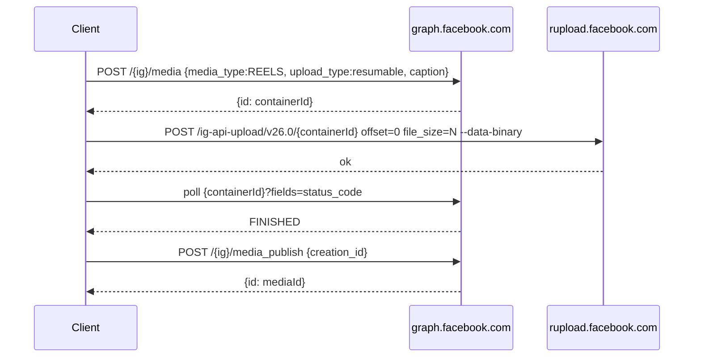
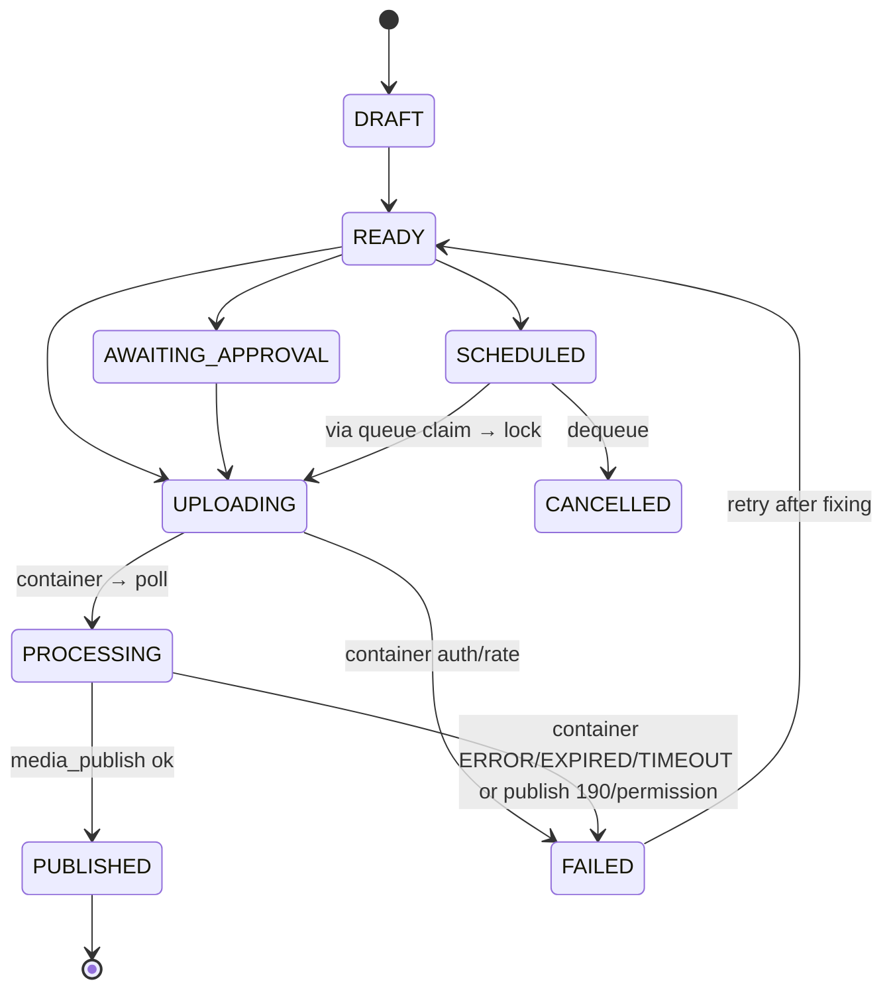

# Instagram Integration — Brain v2.3.0

**Authority:** `brain/js/instagram/**`, `brain/js/util/constants.js`, `brain/server/instagram-exchange.js`. Verified against [`developers.facebook.com`](https://developers.facebook.com/docs/instagram-platform) (re-checked 2026-11-06). Do not invent endpoints.

## 1. Requirements — Business account only

Brain publishes Reels via the **Instagram Graph API** (Facebook Login path). Requirement (Meta docs):

- Instagram **Professional** account (Business or Creator) **linked to a Facebook Page**.
- Personal accounts are rejected (`No Instagram Business account` error from `discoverInstagramAccount`).
- Alternative **Instagram Login** (Creator without Page) via `graph.instagram.com` + Bearer token exists per Meta; Brain documents it as alternative, implements Facebook Login path (`graph.facebook.com`).

## 2. Meta app setup (5 min)

At `developers.facebook.com` → My Apps → Create App (**Business**) → add product **Instagram Graph API** / **Facebook Login**:

| Step | Detail |
|------|--------|
| Redirect URIs | `https://YOUR_HOST/auth/instagram/callback` (+ `http://localhost:8000/auth/instagram/callback` for dev) in *Facebook Login → Settings → Valid OAuth Redirect URIs*. Enable *Client OAuth Login, Web OAuth Login*. |
| Permissions to request | `instagram_basic` (profile), `instagram_content_publish` (Reels), `pages_show_list`, `pages_read_engagement`, `business_management` (discover IG account). `instagram_manage_insights` optional for Insights. |
| Business linking | Instagram app → Settings → Account → *Switch to Professional* → link Page. Add owner’s FB as App **Tester/Admin** for immediate publish (pre-Review). |
| App Review | `instagram_content_publish` beyond test users requires **Business Verification + screencast** (see §13). |

## 3. Hosting configuration

Brain is static. App ID + exchange URL are injected, never hard-coded:

```html
<!-- Option A — meta tag -->
<meta name="brain-instagram-app-id" content="YOUR_APP_ID">
<meta name="brain-instagram-exchange" content="https://YOUR_EXCHANGE/api/instagram/exchange">

<!-- Option B — globals before js/app.js -->
<script>
  window.BRAIN_INSTAGRAM_APP_ID="YOUR_APP_ID";
  window.BRAIN_INSTAGRAM_EXCHANGE_URL="https://YOUR_EXCHANGE/api/instagram/exchange";
  window.BRAIN_INSTAGRAM_REDIRECT_URI="https://YOUR_HOST/auth/instagram/callback";
</script>
```

Local dev fallback: enter App ID in Instagram screen → saved as `localStorage brain:instagram:appId`. Graph version override: `localStorage brain:graph:version`, `<meta name="brain-graph-version" content="v26.0">`, or `window.BRAIN_GRAPH_VERSION`.

Source: `config.js:CONFIG.get appId/redirectUri/exchangeEndpoint/apiVersion/graphBase/oauthDialog`.

## 4. API configuration — current version

| Constant | Value | Source |
|----------|-------|--------|
| `INSTAGRAM_API_VERSION` | `v26.0` | `constants.js:19` |
| `INSTAGRAM_OAUTH_DIALOG` | `https://www.facebook.com/v26.0/dialog/oauth` | `constants.js:20` |
| `INSTAGRAM_TOKEN_ENDPOINT` | `https://graph.facebook.com/v26.0/oauth/access_token` | `constants.js:21` |
| `INSTAGRAM_GRAPH_ENDPOINT` | `https://graph.facebook.com/v26.0` | `constants.js:22` |
| Server `GRAPH_VERSION` | `v26.0` | `server/instagram-exchange.js:12` |
| Fallback `CONFIG.apiVersion` | `v26.0` | `config.js:46` |
| `CONFIG.graphBase` | `https://graph.facebook.com/${apiVersion}` | `config.js:49` |

Chronology (docs `api-compatibility.md`): `v21.0` (2025) → `v22.0 2025-01-21` → `v23.0 2025-05-29` → `v24.0 2025-10-08` → `v25.0 2026-02-18` → **`v26.0 2026-07-29` latest stable** (≈2 y support). `v21.0` retires 2027-01-21. Override without code change via meta/localStorage as above.

## 5. OAuth authorization

```
User taps Connect Instagram
  → generateState(): 32 random bytes + Date.now prefix → sessionStorage(brain:instagram:oauth_state + _ts)
  → redirect GET https://www.facebook.com/v26.0/dialog/oauth?client_id=APP_ID&redirect_uri=...&scope=instagram_basic,instagram_content_publish,pages_show_list,pages_read_engagement&state=...&response_type=code
  → user Allow → redirect YOUR_HOST/auth/instagram/callback?code=...&state=...
  → validateState(stored): format ^[a-z0-9]+-[0-9a-f]{64}$, single-use (removed even on format fail), mismatch→CSRF error, 10-min expiry, clock-skew -1s
  → parseCallbackParams + validateCallbackParams(code ^[A-Za-z0-9._-]{10,500}$)
  → exchangeCodeForToken(code → POST exchangeEndpoint {code, redirect_uri})
  → discoverInstagramAccount(accessToken): me/accounts → instagram_business_account → profile
  → buildConnectedConnection({igUserId, username, pageId, accessToken, expiresIn, scopes}) → settings.instagram
```

`App Secret` never leaves `server/instagram-exchange.js` env (`FACEBOOK_APP_SECRET`). If no exchange endpoint, `needsManual:true` → manual long-lived token UI (testing only).

See diagram in `architecture.md` §9.

## 6. Permissions

| Scope | Purpose |
|-------|---------|
| `instagram_basic` | Read `id,username,name,profile_picture_url,followers_count,account_type`. |
| `instagram_content_publish` | `POST /{ig}/media` + `media_publish`. Requires App Review for prod. |
| `pages_show_list` + `pages_read_engagement` + `business_management` | `me/accounts` → `instagram_business_account` discovery. |
| `instagram_manage_insights` (optional) | `GET /{ig}/insights`. 403 → `needsPermission`, fallback `localInsights`. |

Minimum `INSTAGRAM_MIN_SCOPES = [instagram_basic, instagram_content_publish]`. Validation `hasRequiredScopes`.

## 7. API hosts & endpoint responsibilities

| Host | Auth | Used for |
|------|------|----------|
| `https://www.facebook.com/v26.0/dialog/oauth` | Query `client_id/scope/state` | Authorization code. |
| `https://graph.facebook.com/v26.0` | `access_token` query/body | `me/accounts`, `{page}/instagram_business_account`, `{ig}/media|media_publish`, `{id}?fields=status_code`, `me/permissions` (revoke), `oauth/access_token`, `me/insight` alternative. |
| `https://graph.instagram.com/v26.0` | Bearer (alternative) | Creator-no-Page path (documented, not current default). |
| `https://rupload.facebook.com/ig-api-upload/v26.0/{containerId}` | OAuth header `offset`/`file_size` | Resumable upload alternative (`upload_type=resumable`). Brain primary is `video_url`; resumable investigated, documented in `mediaTransfer.js`/`api-compatibility.md`. |
| Your `supabase.co`/`amazonaws.com`/`r2.cloudflarestorage.com` (user-chosen) | Presigned URL | Where `video_url` points — **Meta fetches it**, not Brain’s server. |
| Your `YOUR_EXCHANGE` | `ALLOWED_ORIGINS/REDIRECT_URI` CORS | `POST /exchange` + `/exchange/refresh` stateless `code↔token`. |

All `fetch` in `brain/js` is only in `auth.js`/`api.js`/`insights.js` → `graph.facebook.com/ facebook.com` + exchange.

## 8. Token lifecycle

| Stage | Detail |
|-------|--------|
| Short-lived | 1 h, returned from `POST /oauth/access_token` (code→token). |
| Long-lived | 60 d via `fb_exchange_token` (`server/instagram-exchange.js` → `llUrl grant_type=fb_exchange_token`). |
| Storage | `settings.instagram {connected, igUserId, username, name, pageId, profilePictureUrl, accessToken, tokenType, expiresAt:ISO, connectedAt, lastValidatedAt, scopes}` in IndexedDB only. |
| Expiry | `isTokenExpired` `Date.now() >= expiresAt-5min`; `tokenExpiresIn`, `tokenExpiryLabel` (`12 min / 3h / 5 days`), `needsRefresh <24h`, `getConnectionStatus→connected|expired|disconnected|incomplete`. Checked on boot + before `executePublish`. |
| Refresh | `refreshLongLivedToken(accessToken)` → `POST {exchangeEndpoint}/refresh {access_token}` → `graph.facebook.com/oauth/access_token?grant_type=fb_exchange_token`. |
| Revocation | `revokePermissions(token, userId)` `DELETE graphBase/me|user/permissions?access_token=…`; local `buildDisconnectedConnection()` always runs even if network fails. `cleanCallbackUrl()` removes `code/state/error` from history. |
| Errors | `authErrorFrom` maps `code 190→expired/revoked`, `4/429→rate`, `10→permission`, `200→personal account`. |

## 9. Reel media requirements

`MEDIA_REQUIREMENTS` (`config.js:52-63` / `constants.js:27-43`):

| Field | Constraint |
|-------|------------|
| Formats | `mp4, mov, quicktime` (MIME `video/mp4, video/quicktime, video/mov, video/x-m4v`, extension `.mp4 .mov .m4v .quicktime`) |
| Codec | H.264 video + AAC audio (probe will error on corrupt). |
| Duration | 3–900 s; **rec. ≤90 s** for Reels (warn if >90 s). |
| Resolution | ≥320×480; rec. 1080×1920 9:16; warns if landscape or <720p. Aspect allow `[9:16,4:5,1:1]` tol 0.08. |
| Size | ≤1 GB hard; client soft warn at 250 MB. |
| Caption | ≤2200 chars, `buildCaptionWithHashtags(caption+tags)` truncates caption to fit. |
| Hashtags | ≤30, each ≤80, `/[^a-zA-Z0-9_]/` rejected, dedup lowercased. |
| Cover | Optional `cover_url` (hosted image); `coverPicker.js` canvas frame → local `dataUrl` preview, hosted via same `video_url` temp host for Graph. |

Local validation: `validateFileBasics(file)` (empty/MIME/size) + `probeVideoMetadata(file)` (`videoElement+createObjectURL+15s timeout` → width/height/duration/aspectLabel/errors). Both must pass for publish.

## 10. Resumable upload workflow (alternative)



Brain’s **current** primary is `video_url` (privacy-audited temp link) → `rupload` is `directUploadInvestigation` documented alternative; `api.js:apiBase()` + `config.graphBase` both respect `v26.0`.

## 11. Publishing & container processing



- **Preview:** `preparePublishPreview(draft, connection)` — **no network** — needs `tempVideoUrl`, builds caption, shows `igUserId, videoName, videoMeta W×H·dur·MB, caption, videoUrl, coverUrl`. Blocks if `!connected|!accessToken`.
- **Publish:** `executePublish(draftId, connection, {actor})` — blocks `MANUAL` automation actor, duplicate guard, expiry/container expiry check, rate check, `PUBLISHED lock UPLOADING→PROCESSING`, `publishReel → fetchPermalink`, record `instagramPublication`, cleanup `tempVideoUrl:null`.
- **Rate:** `INSTAGRAM_PUBLISH_LIMITS DAILY 25 HOURLY 5` advisory; `checkRateLimit` defer `30m` at `processQueue` top; never assumed authoritative.
- **Errors:** `authErrorFrom` → user-facing `Instagram access expired… / rate limit… / Missing permission… / Permission denied Personal accounts` + `code 190 authExpired, 4 rateLimited`. Never claims success before Meta confirms; failures persist as `lastError + history`.

## 12. Insights

`fetchInsights(igUserId, accessToken, [impressions,reach,profile_views])` → `GET ${graphBase}/{ig}/insights?metric=…&period=day`. 403→`needsPermission`; fallback `localInsights(store)` `{byStatus,totalDrafts,publishedThisMonth,failed,queueLen}`; `formatInsightsReport`.

## 13. Rate limits & error handling

| Code | Meaning | Brain |
|------|---------|-------|
| `190` | Invalid/expired token | `authExpired true` → reconnect banner |
| `4` / 429 | Rate | `rateLimited true`, queue defer 30 m, backoff 10 m |
| `10` | Permission | `Missing permission. Reconnect…` |
| `200` | Permission (Personal) | `Permission denied. Business/Creator required.` |
| `status_code EXPIRED/ERROR/TIMEOUT` | Container expired/processing fail | `FAILED lastError` → manual retry after `isContainerExpired` recreates |

`classifyRetry(errorMsg)` maps to `rate-limited 10m / transient / permanent / auth` for `processQueue` backoff decisions.

## 14. Disconnect & revocation

`Disconnect` → confirm → `revokePermissions(token, igUserId)` `DELETE {graphBase}/me|user/permissions?access_token=` (best-effort) → `buildDisconnectedConnection(){connected false, token '', …}` → `store.updateSettings(instagram)` + toast. Token cleared even if revoke network fails.

## 15. Manual & automated modes

| Mode | Setting | Who publishes |
|------|---------|---------------|
| `MANUAL` (default) | `instagram.automation {enabled false, mode MANUAL, rules[]}` | You queue `READY` → `SCHEDULED` → approve preview → `executePublish(actor=user)`. Automation actor rejected. |
| `AUTOMATED` | `enabled true, mode AUTOMATED, paused false, rules[{enabled, filters, schedule, limits}]` | `isEligibleForAutomation(draft, rule, automation)` must pass; `processQueue(onPublish)` fires eligible, respects `allowedDays/Hours`, `maxPerDay 1..10`, `eligibleDraftIds ≤100` allowlist, per-rule limit, `paused` immediate. |

No rule = no auto-publish. UI in `Automation Centre` → pause/disable/per-rule toggle is authoritative.

## 16. Allowlisting & scheduling limits

- **Allowlist:** `filters.eligibleDraftIds` you tick; empty → requires `tags`/`namePattern` at least one, matched against `draft.hashtags`/`videoName`. Never “all videos”.
- **Schedule:** `pwа cannot wake when closed` → Browser schedules only while page/app can run. Brain implements **local reminder catch-up** (visible reminders, `notificationclick` routing). “Post this Reel at 9am” creates reminder + reminder-action wiring, not a guaranteed background publish. Truthfully documented in setup and UI.

## 17. Production app-review requirements

Beyond test users (App → Roles → Tester/Admin works without Review):

- **Business Verification** + **Permissions → instagram_basic, instagram_content_publish, pages_show_list, pages_read_engagement, business_management** → Request with screencast of Connect → pick video → edit caption → **explicit Publish** → `permalink` + local draft, plus note that only approved video+caption go to Meta and site data is local. See `docs/instagram-setup.md` §9.
- HTTPS, `Strict-Transport-Security`/`X-Content-Type-Options`, no secret in repo, owner backup strategy (video blobs excluded).

References: [`api-compatibility.md`](api-compatibility.md) · [`media-transfers.md`](media-transfers.md) · [`threat-model.md`](threat-model.md) · [`threat-model.md`](../brain/js/instagram/api.js) · [`auth.js`](../brain/js/instagram/auth.js)
