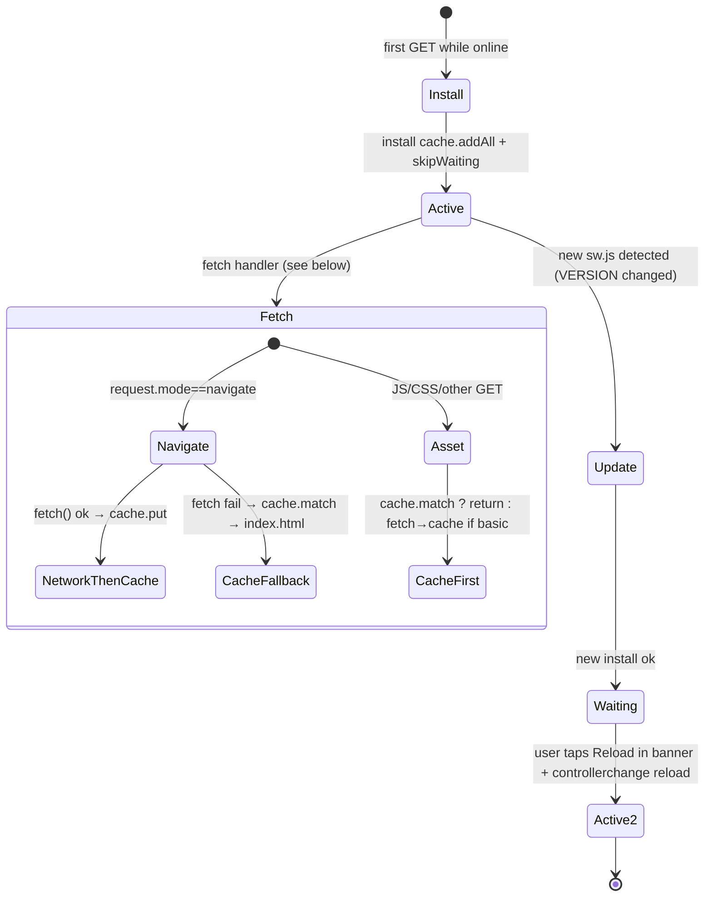

# PWA Lifecycle — Brain v2.3.0

**Source:** `brain/sw.js` (`VERSION=brain-v2.3.0`), `brain/js/install.js`, `brain/js/notify.js`, `brain/manifest.webmanifest`.

## Precached shell (41 assets)

`sw.js ASSETS` (verified by `verify-build.mjs` — fails if any missing):

```
./, ./index.html, ./manifest.webmanifest, ./css/app.css,
./js/app.js, ./js/caps.js, ./js/install.js, ./js/notify.js,
./js/actions/external.js, ./js/actions/system.js,
./js/util/util.js, ./js/util/date.js, ./js/util/constants.js,
./js/store/db.js, ./js/store/store.js, ./js/store/validate.js, ./js/store/migrate.js,
./js/engine/actions.js, ./js/engine/context.js, ./js/engine/intent.js, ./js/engine/search.js,
./js/ui/cards.js, ./js/ui/commandCentre.js, ./js/ui/automationCentre.js, ./js/ui/diagnostics.js,
./js/util/crypto.js, ./js/instagram/config.js, ./js/instagram/auth.js, ./js/instagram/api.js,
./js/instagram/media.js, ./js/instagram/publish.js, ./js/instagram/ui.js, ./js/instagram/stateMachine.js,
./js/instagram/automation.js, ./js/instagram/queue.js, ./js/instagram/coverPicker.js, ./js/instagram/insights.js, ./js/instagram/mediaTransfer.js,
./icons/icon-192.png, ./icons/icon-512.png, ./icons/icon-maskable-512.png, ./icons/apple-touch-icon.png
```

`VERSION` must be bumped each release — old `brain-*` caches auto-clean on `activate`.

## State diagram



| Event | Implementation |
|-------|----------------|
| `install` | `cache.open(CACHE).addAll(ASSETS)` → `skipWaiting()` |
| `activate` | `caches.keys().filter(k.startsWith('brain-') && k!==CACHE).delete` (never IDB, never other app) → `clients.claim()` |
| `fetch` navigate | `fetch(req)` → `cache.put` if ok else `(cache.match(req) \|\| cache.match('./index.html'))` → 503 “Brain is offline” fallback |
| `fetch` assets | `cache.match` first then `fetch→put` if `basic` |
| `notificationclick` | `clients.matchAll` → prefer `focused/visible`, `postMessage brain:reminder-open/action`, else `openWindow(?brainReminderId)` |

No `importScripts` CDN, no push subscription.

## Install & update UX

- **Install prompt:** `install.js` hides `#installBtn` until `beforeinstallprompt` fires; click → `event.prompt()`; `appinstalled` → hide again.
- **iOS fallback:** No `beforeinstallprompt` — show Share → *Add to Home Screen* guidance (no fake button).
- **Update banner:** `registration.onupdatefound` → when `installing` → `updateavailable` toast `Update available — new Brain version ready [Reload] [Later]`; `controllerchange` → `location.reload()`. No silent auto-reload; IDB untouched (data in IDB, not Cache).
- **Interrupted install/activate:** Old SW stays controlling. Next load retries `install`. `activate` atomic `keys.delete` — never partial.

## Offline & reconnection

- **First launch while offline:** `GET` fails → `cache.match(index.html)` serves shell; `Store.init()` reads IDB if present else shows onboarding; if IDB blocked (private mode) → Memory fallback.
- **Browser restart / multi-tab:** Each tab `Store.init()` independent; write queue serializes; `openDb blocked → warning`.
- **Storage pressure:** `storageEstimate()` + `onPersistenceError` → toast + `Temporary storage` banner; quota still retries via 5-pass flush.
- **Private browsing:** IDB unavailable → `MemoryBackend` `_m` ephemeral, warned.
- **Online regain:** `addEventListener('online')` + `online` in `app.js` → `processQueue` + reminder catch-up + `recoverInterruptedPublishes` (poll container if `igContainerId` else `FAILED`).

Mermaid and table verified against `sw.js` verbatim 2026-11-06.
